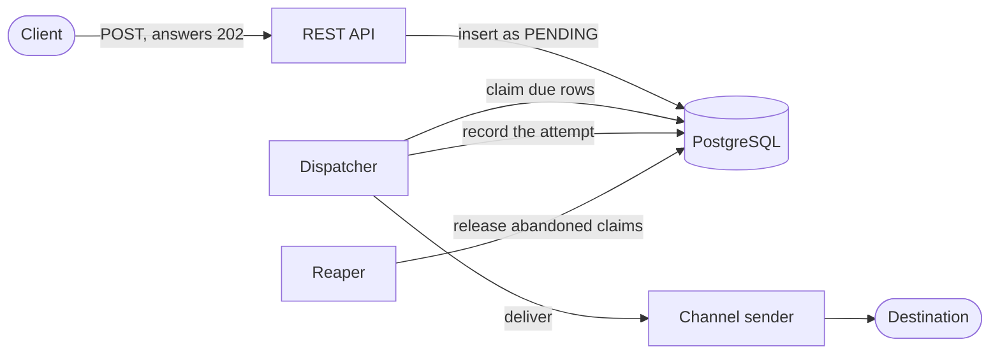
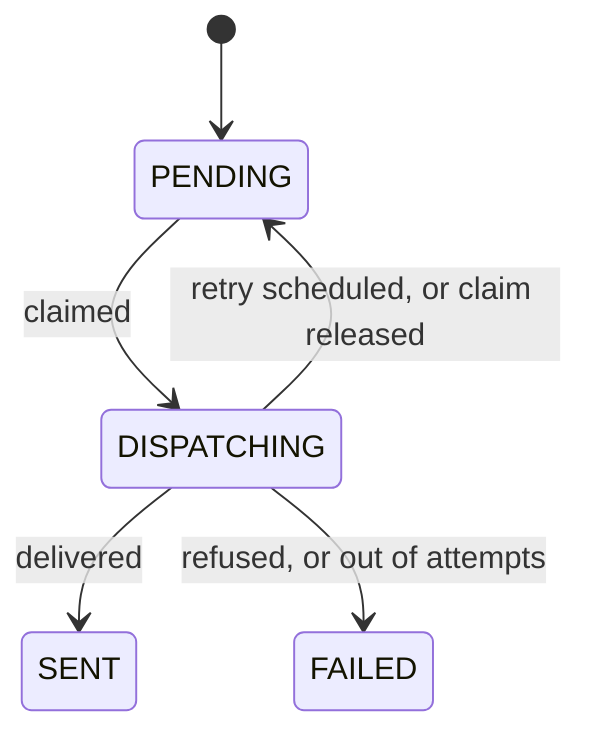

# Notification Hub

[](https://github.com/iaarencibia/notification-hub/actions/workflows/ci.yml)

A service that accepts a notification over HTTP, answers at once, and delivers it in the
background with retries. An accepted notification is never lost, and a slow or broken destination
never stops the service from accepting new ones.

It uses a PostgreSQL table as its work queue. There is no message broker to run.

## Quick start

Docker is the only requirement.

```bash
docker compose up --build
```

Submit a notification. The stack includes a mock destination that answers `200`.

```bash
curl -s -X POST http://localhost:8080/api/v1/notifications \
  -H "Authorization: ApiKey local-dev-api-key-change-me" \
  -H "Content-Type: application/json" \
  -d '{
        "recipient": "http://wiremock:8080/hook/ok",
        "channel": "SERVICE",
        "subject": "Order shipped",
        "body": "Your order 1234 has shipped.",
        "priority": "HIGH"
      }'
```

The answer is `202 Accepted` with the id of the notification:

```json
{"id":"7f1c0f0e-5c3a-4b52-9d3e-2f6a8a1d4c11"}
```

Ask for its state with that id:

```bash
curl -s http://localhost:8080/api/v1/notifications/<id> \
  -H "Authorization: ApiKey local-dev-api-key-change-me"
```

Within a second or two `status` is `SENT`, and `history` holds one attempt.

## Watch a retry

The mock destination has four addresses. Use one as the `recipient` and query the notification
until it settles.

| Recipient | What the destination does | What you see |
|---|---|---|
| `http://wiremock:8080/hook/ok` | Answers `200` | `SENT` after one attempt |
| `http://wiremock:8080/hook/flaky` | Answers `503` twice, then `200` | `SENT` after three attempts, about 25 seconds later |
| `http://wiremock:8080/hook/broken` | Answers `400` | `FAILED` after one attempt, with no retry |
| `http://wiremock:8080/hook/slow` | Takes 15 seconds to answer | `FAILED` after three timeouts, about 40 seconds later |

For the flaky one, `history` ends like this:

```json
[
  {"number": 1, "at": "2026-10-05T22:33:01Z", "outcome": "RETRYABLE_FAILURE", "statusCode": 503, "error": "the destination answered 503"},
  {"number": 2, "at": "2026-10-05T22:33:07Z", "outcome": "RETRYABLE_FAILURE", "statusCode": 503, "error": "the destination answered 503"},
  {"number": 3, "at": "2026-10-05T22:33:23Z", "outcome": "SUCCESS", "statusCode": 200, "error": null}
]
```

The flaky address remembers that it has recovered. Reset it to see the failures again:

```bash
curl -s -X POST http://localhost:8081/__admin/scenarios/reset
```

## How it works



1. **Intake.** The API validates the request and inserts one row as `PENDING`. That insert is the
   record and the enqueue, so there are no two writes to keep in step.
2. **Claim.** Each instance polls for due rows with `FOR UPDATE SKIP LOCKED` and marks them
   `DISPATCHING`. Several instances take different rows without waiting for each other.
3. **Delivery.** The network call runs with no transaction open, so a slow destination never
   holds a database connection.
4. **Result.** The attempt and the new state are written together. A failure that can pass is
   retried with exponential backoff and jitter. One that cannot is final at once.
5. **Recovery.** A reaper returns claims whose instance disappeared. A version column stops a
   late result from overwriting a newer state.



The code follows a hexagonal layout: `domain`, `application` with its ports, and `adapter`.
ArchUnit tests keep the domain and the application free of framework and adapter dependencies.

## API

| Method | Path | Purpose |
|---|---|---|
| `POST` | `/api/v1/notifications` | Submit a notification. Answers `202` with its id |
| `GET` | `/api/v1/notifications/{id}` | State, attempt count and attempt history |

- Every request carries `Authorization: ApiKey <key>`. Only the health probe is open.
- `channel` is `SERVICE`, an HTTP `POST` to the recipient, or `LOG`, a line in the service log.
- `priority` is `HIGH`, `MEDIUM` or `LOW`, and decides the order in which work is claimed.
- An optional `Idempotency-Key` header makes a repeated submission answer with the first id.
- Errors are problem details (RFC 9457) that name each invalid field.

The full contract is in Swagger UI at <http://localhost:8080/swagger-ui.html>. It is served by the
Compose stack and off by default anywhere else.

## Operating it

| What | Where |
|---|---|
| Health and readiness | `/actuator/health`, `/actuator/health/readiness` |
| Metrics for Prometheus | `/actuator/prometheus`, with the API key |
| Logs | JSON in ECS format on standard output, with a `correlationId` per request |
| Configuration | Environment variables, listed with their defaults in [`application.yml`](src/main/resources/application.yml) |

The retry schedule, the timeouts, the poll interval and the pool sizes are all configuration.

### Dashboard

```bash
docker compose --profile monitoring up --build
```

This adds Prometheus at <http://localhost:9090> and Grafana at <http://localhost:3000>. The
"Notification flow" dashboard opens without a login and follows a notification through one row per
stage:

| Row | What it shows |
|---|---|
| Intake | Accepted per channel, refused per reason, idempotent replays |
| Queue | Rows `PENDING` and `DISPATCHING`, read from the table |
| Claim | Claims against acceptances, and how long a due row waited to be claimed |
| Delivery | Attempts per outcome, attempt duration p95, attempts that succeeded |
| Outcome | Sent and failed, retries scheduled, time from acceptance to settlement p95 per priority |
| Recovery | Abandoned claims the reaper released, lost claims, unexpected errors |

Prometheus cannot read environment variables in its configuration, so the development API key is
written in [`prometheus.yml`](docker/prometheus/prometheus.yml). A stack started with another
`NOTIFICATIONS_API_KEY` has to change it there too.

## Tests

```bash
docker compose --profile test run --rm test
```

This runs more than 500 tests: unit tests, integration tests against a real PostgreSQL through
Testcontainers, and the format check. The same command runs on every pull request.

## Design decisions

Each decision has a record with the options it considered, what it costs, and the improvements
planned next.

| Record | Decision |
|---|---|
| [0001](docs/adr/0001-postgresql-table-as-work-queue.md) | A PostgreSQL table as the work queue |
| [0002](docs/adr/0002-claiming-work-with-skip-locked.md) | Claiming work with `SKIP LOCKED` |
| [0003](docs/adr/0003-dispatching-state-and-reaper.md) | The `DISPATCHING` state and the reaper |
| [0004](docs/adr/0004-optimistic-versioning.md) | Optimistic versioning |
| [0005](docs/adr/0005-retry-policy.md) | Retry policy |
| [0006](docs/adr/0006-development-credentials.md) | Development credentials as overridable defaults |
| [0007](docs/adr/0007-shared-api-key-authentication.md) | Shared API key authentication |

## Known limitations

These are deliberate for now. Each record above ends with the steps that would remove them.

- **Delivery is at-least-once.** A destination can receive a notification twice. Every request
  carries `X-Notification-Id` so that it can drop the repeat.
- **One shared API key.** There is no identity per caller and no way to revoke one caller alone.
- **`FAILED` is final.** There is no dead-letter queue and no way to send a failed notification
  again.
- **The defaults give up early.** With three attempts, a destination that is down for more than
  about 20 seconds loses its notifications to `FAILED`.
- **No circuit breaker.** Every notification spends its own attempts against a destination that
  is down.
- **A database outage answers `500`.** While PostgreSQL is unreachable the API answers `500`
  instead of `503` with `Retry-After`, so a caller cannot tell that the failure will pass.
- **Nothing removes old rows.** The tables grow until a retention job exists.
- **The credentials in the repository are development values.** A real deployment must replace
  them, and nothing forces it to.
- **Email is not implemented.** The channel exists in the model and is refused at intake.

## Feedback

Comments on the design are welcome. Open an
[issue](https://github.com/iaarencibia/notification-hub/issues) with what you would have done
differently and why.

## License

[MIT](LICENSE)
